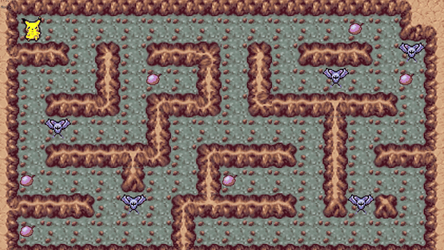

*This project has been created as part of the 42 curriculum by jrenault and validated in 2023.*

# so_long

<p align="center">
  
</p>

## Description

**so_long** is a small top-down 2D game written in C with the **MiniLibX**, 42's minimal X11 graphics library.
The goal: walk through a maze, pick up every collectible, then reach the exit, which only opens once everything has been collected.

The project is about the basics of a graphical program: opening a window, handling keyboard and window events, loading textures, and drawing sprites in a render loop. It also covers parsing and validating a map file.

### Features

- **Map parsing and validation** from a `.ber` file: the map must be rectangular and fully enclosed by walls, with exactly one player and one exit and at least one collectible. A flood fill checks that every collectible and the exit can be reached. Any invalid map exits cleanly with `Error\n` and an explicit message.
- **Move counter** printed in the shell on every step.
- **Clean exit** on `ESC` or the window's close button, with all memory freed.

**Bonus version (`so_long_bonus`)**, shown in the GIF above

- Context-aware walls: each wall tile is picked from 41 variants based on its neighbours, so corridors and corners connect seamlessly.
- Smooth, continuous movement in a real-time game loop: hold a key to keep walking.
- Enemies (`F` on the map): touching one ends the game.
- Sprite animations: a directional walk cycle for the player and an idle animation for enemies.
- Move counter and FPS displayed on screen.

## Instructions

### Requirements

Linux with X11, `cc`, `make`, and the X11 development headers:

```bash
sudo apt install gcc make xorg libxext-dev libx11-dev libbsd-dev
```

The MiniLibX, libft, ft_printf and get_next_line are bundled and built by the Makefile.

### Build

```bash
make          # mandatory version -> ./so_long
make bonus    # bonus version     -> ./so_long_bonus
make clean / make fclean / make re
```

### Run

```bash
./so_long maps/minimal.ber
./so_long_bonus maps/showcase.ber
```

| Key | Action |
| --- | --- |
| `W` `A` `S` `D` | Move |
| `ESC` | Quit |

### Map format

| Char | Meaning |
| --- | --- |
| `0` | Empty floor |
| `1` | Wall |
| `C` | Collectible |
| `E` | Exit |
| `P` | Player start |
| `F` | Enemy (bonus only) |

```
1111111111111
10010000000C1
1000011111001
1P0011E000001
1111111111111
```

## Resources

- [MiniLibX documentation (42 Docs)](https://harm-smits.github.io/42docs/libs/minilibx)
- [MiniLibX source (42Paris/minilibx-linux)](https://github.com/42Paris/minilibx-linux)
- [Flood fill (Wikipedia)](https://en.wikipedia.org/wiki/Flood_fill), used for path validation
- [The XPM format](https://en.wikipedia.org/wiki/X_PixMap)
- The sprites are fan-made Pokémon-style pixel art. All rights belong to their respective owners, and they are used here for non-commercial educational purposes only.
